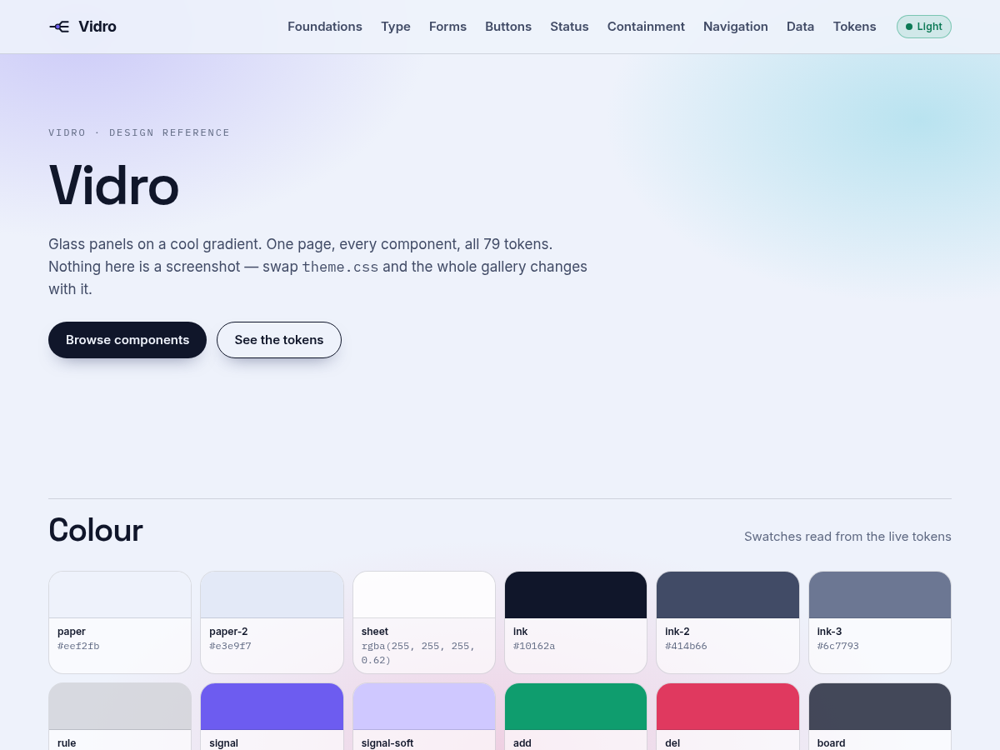

# Vidro — design reference

**Glass panels on a cool gradient**

One page showing every component in this design, rendered from its own design
tokens. No build step, no dependencies: open `index.html`.

**[View the component gallery →](https://mawentory.github.io/design-vidro/)**



## What is here

| File | Purpose |
| --- | --- |
| `index.html` | Component gallery — every component on one page |
| `DESIGN.md` | The design notes: origin, palette, type, shape, measured contrast |
| `theme.css` | The 66 design tokens, plus derived accessibility values |
| `design.css` | Component styles, written against tokens only |
| `fonts.css` | `@font-face` declarations for the fonts this design uses |
| `fonts/` | Latin-subset woff2 files, self-hosted |

`design.css` contains no colour, radius or font literal. That is deliberate: the
same stylesheet drives all ten designs and only `theme.css` differs, so the
gallery doubles as a test that the token set is complete.

## The design

Frosted glass over a cool gradient: translucent panels, a bright edge where each sheet catches light, and a soft coloured ground that never repeats.

**Type** — Inter for text, Space Grotesk at 600 for display, IBM Plex Mono for data. The low display weight keeps headings from punching through the glass.

**Shape** — Large radii (12/18/26px) and 1px hairlines. Elevation is a wide, low-opacity shadow plus a 16px backdrop blur.

**Signature moves**

- Translucent sheet fills over a three-stop fixed gradient.
- Backdrop blur on every panel, modal and popover.
- A bright hairline along the top edge of each panel, as if lit.

## Colour

| Token | Value | Role |
| --- | --- | --- |
| `--paper` | `#eef2fb` | Page ground |
| `--sheet` | `rgba(255, 255, 255, 0.62)` | Raised surfaces |
| `--ink` | `#10162a` | Primary text |
| `--signal` | `#6d5cf0` | Action |
| `--signal-text` | `#6354db` | Action, when it has to be read |
| `--focus-ring` | `#6d5cf0` | Focus indicator |

## Accessibility

Every colour pair this design can render as text is checked against WCAG 2.1
when the repo is generated — page surfaces, panel surfaces, and the tinted fills
of badges and diff lines. The full table is in
[DESIGN.md](DESIGN.md#contrast-measured); the gallery is separately audited in a
real browser for heading order, duplicate ids, unlabelled controls and
horizontal overflow at 1280px and 390px.

## Using it

Set the theme attribute on your root element and load the two stylesheets:

```html
<html data-theme="vidro">
  <link rel="stylesheet" href="fonts.css" />
  <link rel="stylesheet" href="theme.css" />
  <link rel="stylesheet" href="design.css" />
</html>
```

Because the tokens are namespaced by attribute, this theme can sit alongside
another one in the same page.

## The rest of the set

[Placa](https://github.com/mawentory/design-placa), [Blueprint](https://github.com/mawentory/design-blueprint), [Phosphor](https://github.com/mawentory/design-fosforo), [Press](https://github.com/mawentory/design-imprensa), [Swiss](https://github.com/mawentory/design-suico), [Neon](https://github.com/mawentory/design-neon), [Brutalist](https://github.com/mawentory/design-brutalista), [Botanical](https://github.com/mawentory/design-botanico), [Bauhaus](https://github.com/mawentory/design-bauhaus).

---

Part of the MarvinRouter design set. Generated from a single template; see
`DESIGN.md` for the values behind it.
